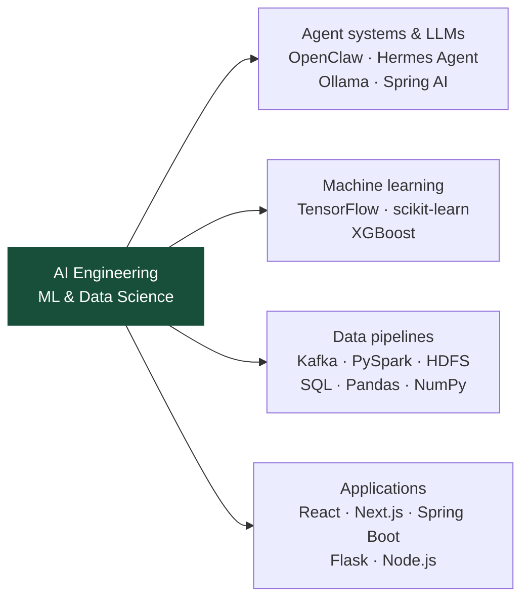

# Reda El Ferrasi

**AI Engineering · Multi-Agent Systems · Machine Learning · Data Science**

  
  

I am a state-qualified engineer in **Data Science and IoT from ENSIAS**, based in Morocco. My focus is AI engineering, machine learning, and data science, supported by full-stack development to turn models and workflows into applications.

## Multi-agent systems & LLM integration

During my final-year project at **Matious Digital (January–September 2026)**, I developed and tested an orchestration platform with **20–40 concurrent AI agents**.

- Integrated **OpenClaw and Hermes Agent** through WebSocket and REST APIs.
- Automated prompt generation, model selection, routing, and error recovery.
- Deployed containerized agents on **Hetzner Cloud**.

My other AI projects use **Spring AI, Ollama, and tool calling**. My [portfolio](https://reda-elferrasi.vercel.app/) includes project case studies, interactive architecture diagrams, and English/French CVs.

## Engineering toolkit

| Area                       | Tools and technologies                                                                                                                                                                                                                |
| -------------------------- | ------------------------------------------------------------------------------------------------------------------------------------------------------------------------------------------------------------------------------------- |
| **AI & machine learning**  |  Python · TensorFlow/Keras · scikit-learn · XGBoost · Ollama · Spring AI                          |
| **Data & infrastructure**  |  Kafka · PySpark · HDFS · SQL · Pandas · NumPy · PostgreSQL · MongoDB · Docker                           |
| **Full-stack development** |  React · Next.js · TypeScript · Java · Spring Boot · Node.js · REST APIs · WebSocket |

## Selected projects

| Project                                               | Focus                                                              | Main technologies                                       |
| ----------------------------------------------------- | ------------------------------------------------------------------ | ------------------------------------------------------- |
| [TalentAI](https://github.com/redaelfer/TalentAI)     | AI-assisted recruitment and candidate matching                     | Spring Boot · Spring AI · Ollama · React · PostgreSQL   |
| [RetinaScan](https://github.com/redaelfer/RetinaScan) | Academic retinal-image classification                              | TensorFlow · MobileNetV2 · Flask · React · Spring Boot  |
| [NosqlAPT](https://github.com/redaelfer/NosqlAPT)     | Machine learning for security-log analysis                         | Python · XGBoost · scikit-learn · TensorFlow · Logstash |
| [BigData](https://github.com/redaelfer/BigData)       | Streaming events from ingestion to storage                         | Kafka · PySpark · HDFS · Python · Docker                |
| [JobOS](https://github.com/redaelfer/JobOS)           | A local workspace for job discovery, tracking, and tailored drafts | Node.js · SQLite · Ollama · LaTeX                       |

Also exploring: [AgentFleet](https://github.com/redaelfer/AgentFleet), a Docker-backed agent-monitoring prototype, and [AI-Agents](https://github.com/redaelfer/AI-Agents), an Ollama assistant with tool calling and a Streamlit interface.

## Connect

I am interested in **AI engineering, machine learning, and data science opportunities**.

[Portfolio & CVs](https://reda-elferrasi.vercel.app/) · [LinkedIn](https://www.linkedin.com/in/reda-elferrasi/) · [All repositories](https://github.com/redaelfer?tab=repositories)
